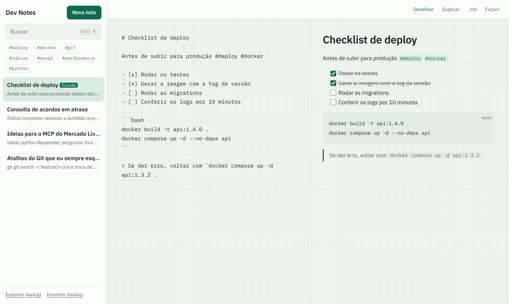
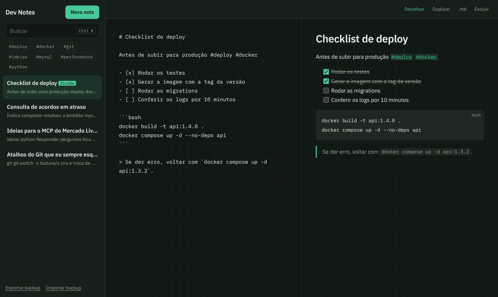
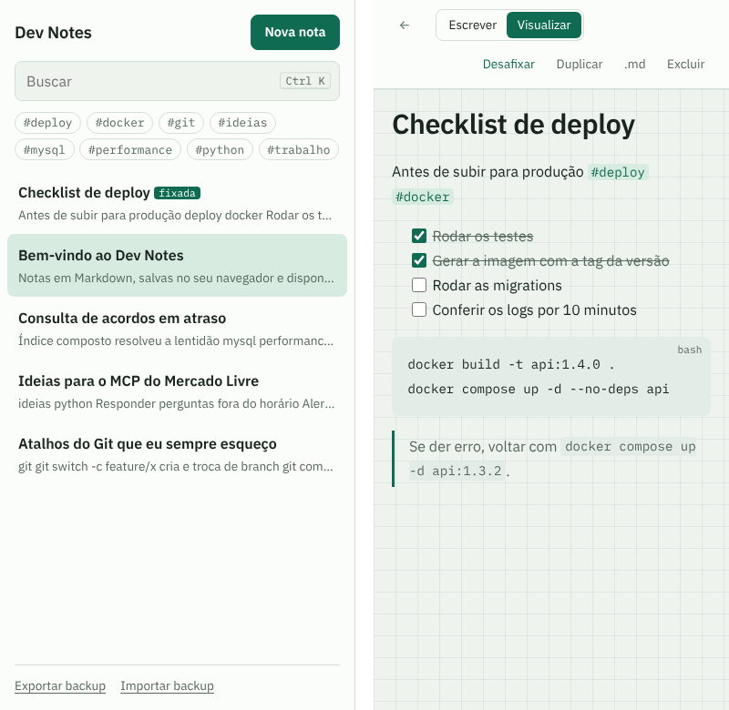

# Dev Notes

[](https://github.com/wagnerglongo/Dev-notes/actions/workflows/test.yml)

Bloco de notas em Markdown feito para desenvolvedores: blocos de código, listas de tarefas, etiquetas e busca. As notas ficam no navegador (IndexedDB), o app **funciona offline** e pode ser **instalado** no computador ou no celular como PWA.

<p align="center">
  
</p>

<p align="center">
  
  
</p>

## Funcionalidades

- **Markdown** com títulos, negrito, itálico, links, citações, listas e blocos de código com a linguagem indicada.
- **Tarefas clicáveis:** marcar `- [ ]` na visualização atualiza o texto da nota.
- **Etiquetas automáticas:** escreva `#docker` em qualquer lugar e a nota aparece no filtro.
- **Busca** que ignora acentos e maiúsculas e exige todas as palavras digitadas.
- **Escrever e visualizar lado a lado** em telas largas; no celular, lista e nota em telas separadas.
- **Fixar, duplicar, baixar como `.md` e excluir com "Desfazer"**, sem caixas de confirmação.
- **Backup** em JSON para exportar e importar, com validação do arquivo.
- **Offline e instalável** (service worker + manifest).
- **Atalhos:** `Alt+N` nova nota, `Ctrl+K` buscar, `Ctrl+E` alternar escrever/visualizar, `Tab` indenta no editor.
- **Modo escuro** automático, seguindo o sistema.

## Decisões técnicas

| Tema | O que foi feito |
|---|---|
| Markdown seguro | Renderizador próprio (`src/markdown.js`). O texto inteiro é **escapado antes** de qualquer transformação, então nenhum HTML digitado vira HTML de verdade. Links só aceitam `http`, `https` e `mailto`. Há testes com tentativas de XSS. |
| Armazenamento | IndexedDB com uma camada fina de Promises (`src/storage.js`) e alternativa em `localStorage` para navegadores que bloqueiam o IndexedDB. |
| Migração | Quem usava a versão antiga tem as notas convertidas automaticamente no primeiro acesso. A versão antiga gerava IDs com `Math.random() * 5000`, que podiam se repetir. A migração dá um ID novo (`crypto.randomUUID`) para cada nota, e isso tem teste. |
| Offline | Service worker com *stale-while-revalidate*: abre instantaneamente do cache e atualiza em segundo plano. Trocar `VERSION` limpa o cache antigo. |
| Regras isoladas | Título, prévia, etiquetas, busca, ordenação, backup e migração são funções puras em `src/notes.js`, sem DOM. A ordenação não altera o array original. |
| Testes e CI | 18 testes com `node --test`, rodando no GitHub Actions. Durante o desenvolvimento, o app também foi testado de ponta a ponta no navegador: migração, tarefas, busca, desfazer, backup e uso sem internet. |
| Sem dependências | HTML, CSS e JavaScript (ES Modules). Fontes IBM Plex hospedadas no projeto. |

## Estrutura

```
├── index.html
├── manifest.webmanifest
├── sw.js                 # service worker (offline)
├── src/
│   ├── markdown.js       # Markdown → HTML seguro, tarefas
│   ├── notes.js          # regras das notas (funções puras)
│   ├── storage.js        # IndexedDB + migração da versão antiga
│   └── main.js           # interface, atalhos, backup, PWA
├── tests/                # node --test
├── icons/                # ícone SVG + PNGs gerados por scripts/icons.mjs
└── assets/               # CSS e fontes
```

## Rodando localmente

```bash
git clone https://github.com/wagnerglongo/Dev-notes.git
cd Dev-notes
npm run dev    # http://localhost:3000 (o service worker funciona em localhost)
npm test       # Node 20+
```

---

Desenvolvido por [Wagner Longo](https://github.com/wagnerglongo).
